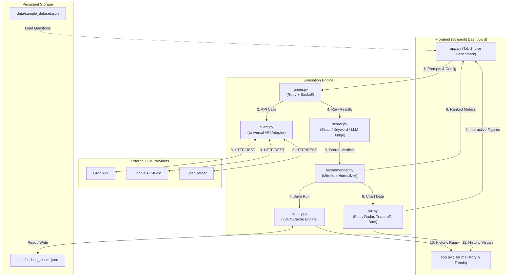

# ⚡ Pick My LLM — Complete Project Deep Dive & Portfolio Architecture

> **What happened, how it works, line-by-line explanation, and advanced portfolio features.**

---

## 🗂️ Table of Contents

1. [What Is This Project?](#1-what-is-this-project)
2. [How It Works — Big Picture Flow](#2-how-it-works--big-picture-flow)
3. [Project File Structure](#3-project-file-structure)
4. [Line-by-Line Code Walkthrough](#4-line-by-line-code-walkthrough)
   - [app.py — Main Streamlit UI & Tabbed Dashboard](#-apppy--main-streamlit-ui--tabbed-dashboard)
   - [core/client.py — Universal API Adapter](#-coreclientpy--universal-api-adapter)
   - [core/runner.py — Benchmark Orchestrator & Rate Limiter](#-corerunnerpy--benchmark-orchestrator--rate-limiter)
   - [core/scorer.py — Multi-Mode Answer Evaluator](#-corescorerpy--multi-mode-answer-evaluator)
   - [core/recommender.py — Min-Max Normalizer & Ranking Engine](#-corerecommenderpy--min-max-normalizer--ranking-engine)
   - [core/viz.py — Interactive Plotly Radar & Breakdown Visualizations](#-corevizpy--interactive-plotly-radar--breakdown-visualizations)
   - [core/history.py — Persistent Benchmark Run History Cache](#-corehistorypy--persistent-benchmark-run-history-cache)
   - [data/sample_dataset.json — Multi-Domain Test Questions](#-datasample_datasetjson--multi-domain-test-questions)
5. [System Architecture Diagram](#5-system-architecture-diagram)
6. [Status of Portfolio Features](#6-status-of-portfolio-features)
7. [How to Deploy to Streamlit Cloud](#7-how-to-deploy-to-streamlit-cloud)
8. [How to Present This on Your Portfolio & Resume](#8-how-to-present-this-on-your-portfolio--resume)

---

## 1. What Is This Project?

**Pick My LLM** is an open-source **AI model benchmarking & decision recommendation engine** built with Python and Streamlit.

### The Problem It Solves:
When building LLM-powered applications, developers struggle to choose the best model. Paid benchmarking services are expensive, while generic leaderboards (like LMSYS Chatbot Arena) evaluate generic chatbot vibes rather than **your specific questions, domain accuracy, latency constraints, and operational cost**.

### What This Tool Does:
- **Simultaneous Evaluation:** Tests identical prompts concurrently across Groq (Llama), Google AI Studio (Gemini), and OpenRouter (Mistral).
- **Flexible Scoring:** Evaluates answers via **Deterministic Exact Match**, **Substring Keyword Matching**, or **LLM-as-a-Judge** (using an independent AI to grade open-ended answers).
- **Multi-Attribute Optimization:** Uses min-max normalized weighted scoring so users can adjust sliders (Accuracy %, Speed, Cost) to receive a custom-tailored recommendation.
- **Interactive Multi-Dimensional Visualizations:** Dynamic Plotly Radar / Spider profiles, Pareto frontier speed-vs-accuracy trade-offs, and category-wise performance bars.
- **Persistent Historical Benchmarks:** Automatically logs runs to disk (`cached_results.json`) so users can compare runs, audit latency trends, and download past CSVs.

---

## 2. How It Works — Big Picture Flow

```
                      User (Browser)
                            │
               ┌────────────┴────────────┐
               ▼                         ▼
      [Tab 1: Live Benchmark]   [Tab 2: History & Trends]
               │                         │
       Select Models & Prompts     Select past run from dropdown
               │                         │
        Run Benchmark              Inspect past Leaderboard & Radar
               │
    ┌──────────┴──────────┐
    ▼                     ▼
Demo Mode           Live API Calls (runner.py)
(Mock Data)               │  [Exponential Backoff retry]
                          ▼
                    client.py (Groq / Gemini / OpenRouter)
                          │
                          ▼
                    scorer.py (Exact / Keyword / LLM Judge)
                          │
                          ▼
                    recommender.py (Min-Max Normalize & Rank)
                          │
          ┌───────────────┴───────────────┐
          ▼                               ▼
    history.py (Save to JSON)      viz.py (Plotly Radar, Trade-off, Bars)
          │                               │
          └───────────────┬───────────────┘
                          ▼
              Render Leaderboard & Visuals
```

---

## 3. Project File Structure

```
pick_my_llm/
│
├── app.py                    ← Main Streamlit Dashboard (Tabs: Live Benchmark & History)
├── requirements.txt          ← Production dependencies (Streamlit, Plotly, GenAI, Groq, OpenAI)
├── .env.example              ← Template documentation for API keys
├── .gitignore                ← Excludes venv/, credentials, and caches from Git
├── README.md                 ← Comprehensive documentation with badges, setup, and roadmap
├── PROJECT_DEEP_DIVE.md      ← Complete line-by-line guide, architecture & portfolio strategies
│
├── core/
│   ├── __init__.py           ← Marks core as an importable Python package
│   ├── client.py             ← Universal API adapter (Groq, Google AI Studio, OpenRouter)
│   ├── runner.py             ← Orchestrates prompt execution with exponential backoff retries
│   ├── scorer.py             ← Exact match, keyword match, and LLM-as-a-judge
│   ├── recommender.py        ← Cost simulation, min-max normalization, and weighted ranking
│   ├── viz.py                ← Interactive Plotly charts (Radar profiles, Category bars, Trade-off)
│   └── history.py            ← JSON run caching, history inspection, and run management
│
└── data/
    ├── sample_dataset.json   ← Multi-domain questions (Python, GK, Gujarati, ML, Logic)
    └── cached_results.json   ← Persistent JSON store for historical benchmark runs
```

---

## 4. Line-by-Line Code Walkthrough

---

### 📄 `app.py` — Main Streamlit UI & Tabbed Dashboard

- **Lines 1–10:** Imports Streamlit, Pandas, and internal modules (`runner`, `scorer`, `recommender`, `history`, `viz`).
- **Lines 12–16:** `st.set_page_config()` establishes full-width screen real estate and modern tab titles.
- **Lines 19–27:** Injects custom CSS styling and renders brand headers.
- **Lines 32–43:** Renders password-masked sidebar input boxes for Groq, Google AI Studio, and OpenRouter keys (stored strictly in memory).
- **Lines 47–51:** User-tunable sliders for Accuracy, Latency, and Cost weights.
- **Lines 54–75:** Scoring method selection: Auto (Exact/Keyword) vs. **LLM-as-a-Judge** with customizable judge model and provider.
- **Lines 77:** Demo Mode toggle for testing without active API keys.
- **Lines 82–83:** Establishes the two main tabs: `[🚀 Live Benchmark, 📜 Benchmark History & Trends]`.
- **Lines 86–103:** 3-column model picker allowing simultaneous multi-provider selection.
- **Lines 107–133:** Dataset loader (supports custom `.json` upload with fallback to built-in questions).
- **Lines 139–167:** Execution trigger button with demo simulation fallback or live async dispatch.
- **Lines 170–210:** Dynamic evaluation loop: computes exact/keyword matches or queries the **LLM Judge**, rendering a live progress bar.
- **Lines 212–224:** Results aggregation, normalization, ranking, and auto-logging to `data/cached_results.json` via `save_run()`.
- **Lines 226–275:** Rich presentation: Summary alert, leaderboard table, interactive Plotly Radar chart, speed vs. accuracy trade-off, category-wise breakdown, and CSV download.
- **Lines 279–360 (Tab 2):** Benchmark history viewer: Loads past runs, shows key metrics, allows inspection of previous charts/leaderboards, and supports single-run deletion or clearing all history.

---

### 📄 `core/client.py` — Universal API Adapter

- **Lines 1–6:** Imports SDKs: `google.genai`, `groq`, and `openai`.
- **Lines 8–19:** `call_llm(provider, model_name, prompt, api_key)` signature returning a standardized payload `{response, latency, prompt_tokens, completion_tokens, error}`.
- **Lines 20–27:** Starts millisecond timer and sets default return structure.
- **Lines 30–41:** Groq client initialization and completion request with `temperature=0.1` for reproducible evaluations.
- **Lines 42–52:** Google Gemini client call using the new unified `google-genai` SDK and extracts usage metadata token metrics.
- **Lines 53–67:** OpenRouter client routed through OpenAI's SDK using `base_url="https://openrouter.ai/api/v1"`.
- **Lines 71–75:** Universal exception handler preventing application crashes upon API timeouts or rate limits, calculating elapsed response seconds.

---

### 📄 `core/runner.py` — Benchmark Orchestrator & Rate Limiter

- **Lines 5–18:** `run_benchmark(...)` loops through Cartesian product of $(Questions \times Models)$.
- **Lines 32–46:** Gracefully handles missing API keys by recording an explicit error record rather than breaking execution.
- **Lines 48–63:** **Exponential Backoff Retry Engine:** Detects HTTP 429 and rate-limit exceptions, waiting $delay \times 2^{attempt}$ seconds (up to 3 retries).
- **Lines 78–80:** Enforces polite delay between calls to respect free-tier RPM/TPM thresholds.

---

### 📄 `core/scorer.py` — Multi-Mode Answer Evaluator

- **Lines 4–14:** `score_exact_match()`: Sanitizes whitespace (`strip()`) and casing (`lower()`) for precise MCQ answers.
- **Lines 16–23:** `score_keyword_match()`: Substring inclusion check for concise responses.
- **Lines 25–54:** `score_llm_judge()`: Constructs an objective evaluation prompt and sends it to an independent LLM to grade open-ended outputs as `CORRECT` or `WRONG`.

---

### 📄 `core/recommender.py` — Min-Max Normalizer & Ranking Engine

- **Lines 6–12:** `MODEL_PRICING` dictionary mapping input/output cost per 1M tokens.
- **Lines 14–33:** `calculate_costs()`: Calculates estimated costs from actual token consumption.
- **Lines 35–61:** `aggregate_results()`: Groupby aggregation calculating total questions, accuracy %, mean latency, and total simulated expenditure.
- **Lines 63–111:** `rank_models()`: Applies min-max normalization:
  - Accuracy: $(value - min) / (max - min)$
  - Latency: $(max - value) / (max - min)$ (inverted because lower is better)
  - Cost: $(max - value) / (max - min)$ (inverted because lower is better)
- **Lines 113–133:** `generate_recommendation_summary()`: Automated plain-English summary highlighting the winning model and trade-off comparison.

---

### 📄 `core/viz.py` — Interactive Plotly Radar & Breakdown Visualizations

- **`create_radar_chart(ranked_df)`:**
  - Plots 4 dimensions on polar axes: Accuracy (%), Speed Score, Cost Efficiency, and Overall Score.
  - Closes the polygon loop and renders each model with distinct neon colors and translucent fill.
- **`create_category_chart(results_df)`:**
  - Grouped bar chart comparing accuracy across topics (e.g. Python vs Gujarati vs ML).
- **`create_tradeoff_chart(ranked_df)`:**
  - Scatter plot plotting Latency (X-axis) against Accuracy (Y-axis) with bubble sizes corresponding to Overall Score.

---

### 📄 `core/history.py` — Persistent Benchmark Run History Cache

- **`load_history()`:** Reads `data/cached_results.json` safely, handling empty or non-existent files.
- **`save_run(ranked_df, results_df, weights, scoring_mode)`:**
  - Structures run metadata with timestamp, winner name, accuracy, and full JSON tables.
  - Prepends the latest run to ensure reverse-chronological order.
- **`delete_run(run_id)` & `clear_history()`:** Provides full CRUD management directly from the UI.

---

## 5. System Architecture Diagram



---

## 6. Status of Portfolio Features

| Priority | Feature Description | Status | Implementation Detail |
|---|---|---|---|
| **#1** | **LLM-as-a-Judge Evaluation** | ✅ **Complete** | Live in `app.py` + `scorer.py` with provider selector & progress bar |
| **#2** | **Persistent Run History Dashboard** | ✅ **Complete** | Built in `core/history.py` + Tab 2 in `app.py` with run inspection & deletion |
| **#4** | **Multi-Attribute Plotly Radar Chart** | ✅ **Complete** | Built in `core/viz.py`, renders Accuracy, Speed, Cost, and Final Score |
| **#5** | **Category-Wise Breakdown Chart** | ✅ **Complete** | Grouped Plotly bar chart across question categories |
| **#7** | **Deploy Readiness Files** | ✅ **Complete** | `requirements.txt`, `.gitignore`, `.env.example`, and full `README.md` |
| **#3** | Custom Model Dynamic Input | ⏳ Next | Add text box for arbitrary HuggingFace/OpenRouter model slugs |
| **#6** | PDF / HTML Export Report | ⏳ Next | Generate styled downloadable report |
| **#8** | Token Efficiency Metric | ⏳ Next | Compute tokens-per-correct-answer ratio |
| **#9** | System Prompt Comparison | ⏳ Next | Prepend custom system prompts to evaluate instruction following |

---

## 7. How to Deploy to Streamlit Cloud

1. **Push your code to GitHub:**
   ```bash
   git init
   git add .
   git commit -m "feat: complete pick_my_llm benchmarking engine with history & radar charts"
   git remote add origin https://github.com/YOUR_USERNAME/pick_my_llm.git
   git push -u origin main
   ```
2. **Deploy on Streamlit Community Cloud:**
   - Navigate to [share.streamlit.io](https://share.streamlit.io).
   - Select your repository and branch `main`.
   - Set **Main file path** to `app.py`.
   - Click **Deploy**.

---

## 8. How to Present This on Your Portfolio & Resume

### 📌 Resume Bullet Points:
```
• Engineered "Pick My LLM", an open-source multi-provider LLM benchmarking & recommendation platform 
  evaluating models concurrently across Groq, Google Gemini, and OpenRouter APIs.

• Architected an evaluation pipeline supporting Exact Match, Substring Matching, and LLM-as-a-Judge patterns, 
  incorporating exponential backoff retry mechanisms to handle free-tier API rate limits.

• Designed a min-max normalized multi-criteria decision algorithm weighting Accuracy, Latency, and Simulated 
  Token Cost to deliver customized model recommendations visualized via Plotly Radar Profiles and historical dashboards.
```

### 🗣️ In Technical Interviews:
- **Architecture:** *"I decoupled provider clients using a universal adapter pattern, allowing any model from Groq, Gemini, or OpenRouter to be evaluated under identical benchmark conditions."*
- **Evaluation Rigor:** *"Rather than relying purely on regex or string equality, I integrated an LLM-as-a-judge module for semantic validation of open-ended and non-deterministic model outputs."*
- **Decision Engine:** *"I normalized disparate units (percentages, seconds, micro-dollars) onto an inverted 0–1 scale so users could define customized weightings reflecting their real-world engineering constraints."*
